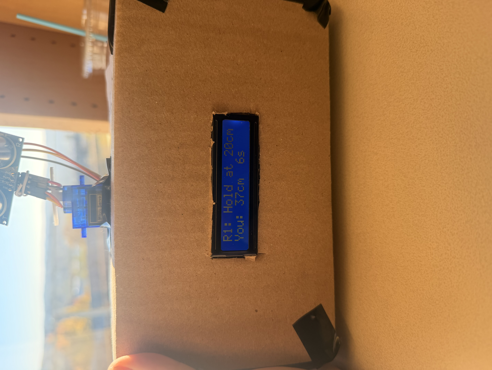
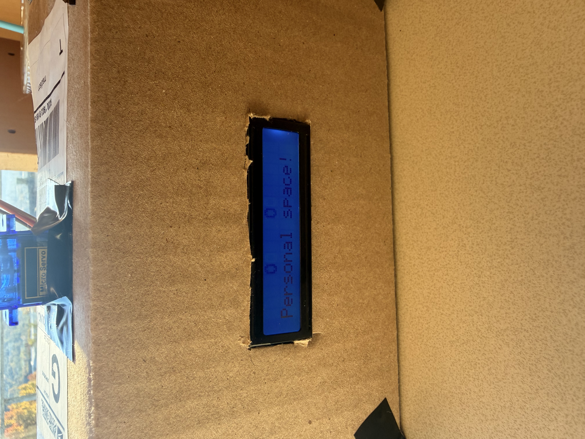

# Pip: Interactive Arduino Desk Robot

**A desk robot that reacts to your hand with a moving head, animated eyes, and chirps, plus a touch-free distance game.**

Built by **Madison Golbon**, Electrical and Computer Engineering student at Cornell University, for the Cornell Assistive Technologies (CAT) new-member Arduino project.

I wanted to turn the parts in an ELEGOO Uno R3 Super Starter Kit into a robot with personality. Pip combines an ultrasonic sensor, a servo, a character LCD, and a buzzer in a handmade cardboard body.

<!-- Add a finished photo to images/pip-front.jpg, then uncomment this line:

-->

## What Pip does

- **Looks around:** scans a small, tested range from 80 to 100 degrees.
- **Reacts to proximity:** shows happy eyes and a greeting when an object is 10–30 cm away, or a surprised expression when it is closer than 10 cm.
- **Blinks and chirps:** uses custom LCD characters and rising or falling tones. Mood sounds are rate-limited to avoid constant beeping.
- **Plays a game:** asks the player to match three target distances with their hand and displays a score out of three.
- **Sleeps and wakes:** closes its eyes and stops scanning after 15 seconds without a nearby detection. A hand in front wakes it.

Pip scans a programmed pattern; it does not track or identify people. The sleep behavior is a software interaction mode, not microcontroller low-power sleep.

### Distance game

Pip displays the target distance, measured distance, and time remaining.

### Personal space reaction

When an object gets closer than 10 cm, Pip shows surprised eyes and says “Personal space!”

## Play the distance game

1. Wait at least five seconds after startup or waking.
2. Hold a flat palm facing the sensor, **12–22 cm away**, for about **1.2 seconds**. Pip centers its head and displays `Hold to play...`.
3. Match the targets in order: **20 cm, 12 cm, and 25 cm**.
4. Stay within **±3 cm** of each target for about **0.6 seconds**. Each round has a **15-second** time limit.
5. Pip gives feedback after each round, displays the total score, then returns to scanning.
6. Before another game, let Pip detect your hand **more than 30 cm away** while scanning. Wait for the five-second cooldown, then repeat the start gesture.

Both hold checks tolerate gaps of up to 350 ms between valid in-range readings. A longer gap resets the hold. Success is checked on an in-range reading; brief gaps count toward the elapsed hold window.

To test sleep, leave the area within 60 cm clear for 15 seconds. Wake Pip by holding a hand within 40 cm directly in front of the centered sensor. It requires three consecutive valid nearby readings. A wall or another object within 60 cm can keep it awake.

## Hardware

| Component | Purpose |
|---|---|
| ELEGOO Uno R3 / Arduino Uno R3 | Main controller |
| HC-SR04 ultrasonic sensor | Distance measurements |
| SG90 micro servo | Turns the sensor head |
| Parallel LCD1602 / 1602A, 16-pin version | Eyes, messages, game feedback |
| Passive buzzer | Variable-pitch chirps |
| 10 kΩ potentiometer | LCD contrast |
| 220 Ω resistor | LCD backlight series resistor |
| 1 kΩ resistor | Buzzer series resistor |
| Breadboard and jumper wires | Circuit connections |
| Breadboard power module and 9 V battery | Separate regulated servo supply used in this prototype |
| USB cable and laptop | Uno power and programming |
| Cardboard and tape | Body, removable lid, and sensor bracket |

## Wiring

Disconnect USB and battery power before changing connections. The LCD is a **parallel 16-pin display**, not an I2C backpack model.

### Sensor, servo, and buzzer

| Component connection | Destination |
|---|---|
| HC-SR04 VCC | Uno 5V rail |
| HC-SR04 GND | Common ground |
| HC-SR04 TRIG | Uno D7 |
| HC-SR04 ECHO | Uno D8 |
| Servo signal, orange | Uno D9 |
| Servo power, red | External module regulated 5V output |
| Servo ground, brown | External module GND |
| External module GND | Uno GND |
| Buzzer + | Uno A3 through 1 kΩ resistor |
| Buzzer − | Common ground |

A3 is used as a digital output for the buzzer. The Uno's 5V and GND connections feed the breadboard rails shared by the sensor and LCD.

### LCD and contrast

| LCD pin | Label | Destination |
|---|---|---|
| 1 | VSS | Ground |
| 2 | VDD | Uno 5V rail |
| 3 | V0 | Potentiometer middle leg |
| 4 | RS | Uno D12 |
| 5 | RW | Ground |
| 6 | E | Uno D11 |
| 7–10 | D0–D3 | Unconnected |
| 11 | D4 | Uno D5 |
| 12 | D5 | Uno D4 |
| 13 | D6 | Uno D3 |
| 14 | D7 | Uno D2 |
| 15 | A | Uno 5V rail through 220 Ω resistor |
| 16 | K | Ground |

Connect the potentiometer's outer legs to Uno 5V and ground. Keep each leg in a separate breadboard connection group. Adjust the knob until the characters are readable.

### Power and mounting

The Uno runs from laptop USB. The servo uses the power module's **regulated 5V output**, with a shared ground. **Do not connect the module's 5V output to the Uno's 5V rail, and do not connect the 9 V battery directly to the servo.**

The 9 V battery was used for this prototype; runtime and servo performance depend on battery condition. If movement becomes weak or erratic, check the supply and connections before assuming the code is responsible.

The blue servo body is fixed to a cardboard base. A lightweight bracket on the rotating horn holds the sensor above it. Loose wire loops allow the head to turn. The LCD mounts behind a window in the front panel, and the open back/removable lid keeps the electronics accessible. Size the body around the actual breadboard and controller.

## Upload and run

1. Download this repository and open **[Pip_Robot/Pip_Robot.ino](Pip_Robot/Pip_Robot.ino)** in Arduino IDE. Keep the file inside the matching `Pip_Robot` folder.
2. Make sure the Arduino **LiquidCrystal** and **Servo** libraries are available. Install them through Library Manager if the IDE reports a missing library.
3. Select **Arduino Uno** and the board's USB port.
4. Keep the servo supply off while uploading.
5. Upload the sketch. Once uploading succeeds, turn on the servo supply.
6. Check the LCD contrast and confirm that the head has clearance throughout its small sweep.

No Wi-Fi, additional computer program, or serial monitor is needed during normal operation. USB supplies power to the Uno.

## How the firmware works

The sketch uses five states:

| State | Behavior and transition |
|---|---|
| `FRIEND` | Scans, measures proximity, displays expressions, and watches for the game gesture or inactivity. |
| `ASLEEP` | Centers the head and keeps measuring forward until three nearby readings wake Pip. |
| `GAME` | Keeps the head centered and checks the current distance target and round timeout. |
| `FEEDBACK` | Shows a win/timeout reaction for 1.2 seconds, then advances to the next round. |
| `RESULTS` | Displays the score for four seconds, then returns to `FRIEND`. |

The ultrasonic sensor receives a short trigger pulse. Echo duration is converted to distance using `duration × 0.0343 / 2`. No echo, or an estimate outside 2–400 cm, is treated as invalid.

Most behavior is scheduled with `millis()`: readings and display updates are spaced by at least 100 ms, head commands by about 900 ms, and readings are suspended for 250 ms after a head movement. Short startup and chirp delays remain, and `pulseIn()` can block for up to 25 ms. The firmware is therefore not fully nonblocking.

## Development and debugging

I tested the distance sensor, servo, LCD, and buzzer separately before combining them. I then mounted the electronics in the cardboard enclosure and checked the complete interaction.

Two problems shaped the final design:

- **LCD showed a row of blocks:** a loose RW-to-ground connection prevented reliable operation. Reseating the connection restored the display.
- **Game missed a steady hand:** a narrow start range and an immediate reset on a single out-of-range reading made the gesture unreliable. I widened the start range to 12–22 cm, used a ±3 cm target tolerance, shortened the scoring hold, and added a 350 ms grace window.

Other troubleshooting included correcting a disconnected USB port selection and resolving missing/extra braces while combining sketch functions. Building Pip gave me practice integrating sensors and actuators, managing separate power supplies, debugging hardware alongside code, and designing an interaction around imperfect sensor readings.

## Validation and limitations

The assembled prototype's scanning, screen reactions, buzzer, game, and sleep/wake behavior were tested manually during development. The final hold-detection changes were confirmed working on the robot. This repository does not claim automated hardware testing or calibrated measurement accuracy.

- Ultrasonic readings depend on the target's size, angle, and surface. A flat palm facing the sensor works better than the edge of a hand.
- Nearby objects can trigger reactions or keep Pip awake.
- Sleep pauses scanning but leaves the sensor running and the servo attached.
- Targets are fixed, and the head motion is deliberately limited to the tested 80–100° range.

## Repository contents

| Path | Contents |
|---|---|
| `Pip_Robot/Pip_Robot.ino` | Complete working sketch |
| `README.md` | Project overview, wiring, setup, and lessons learned |
| `images/README.md` | Instructions for adding finished photos and demo media |

The sketch's header comments were updated to match its actual timings. The game prompt was shortened to fit the 16-character LCD; control behavior is unchanged from the supplied working version.
